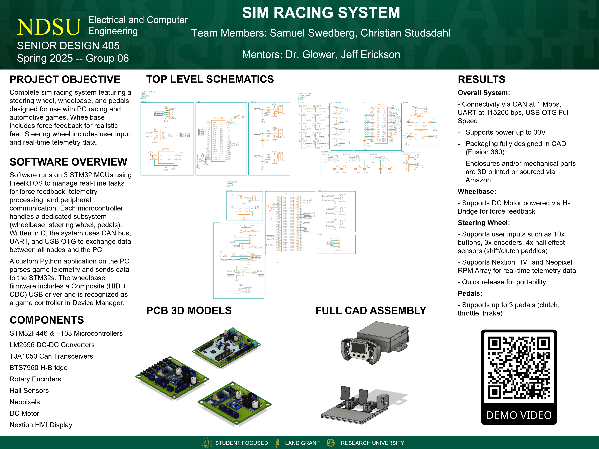

# Sim Racing Wheel System

[](LICENSE)

A fully embedded, custom-built force feedback steering wheel and pedal system designed for PC sim racing. Developed as a year-long senior design capstone at North Dakota State University.

> 🔗 **Project Website:** [samuelswedberg.com](https://www.samuelswedberg.com/)



---

## 🧠 About the Project

This system was designed and built from the ground up with the goal of creating a modular sim racing system that interfaces seamlessly with PC games.

Key components include:

- **Wheelbase** — Powered by an STM32F4 MCU, controlling a DC motor with real-time force feedback
- **Steering Wheel** — Button and encoder inputs, rotary switches, and telemetry display via CAN and UART
- **Pedals** — Analog sensors with adjustable profiles and calibration
- **Communication** — USB Composite HID driver and CAN bus between all devices
- **RTOS** — FreeRTOS handling motor control, peripheral processing, and CAN communication
- **Display** — Real-time telemetry output via Nextion touchscreen

This was an extensive embedded systems project spanning circuit design, firmware development, real-time data communication, mechanical design, and signal processing.

---

## 🏆 Results

Earned top faculty and industry feedback at the **NDSU Senior Design Expo**. The system successfully delivers real-time force feedback with full USB HID game controller recognition on PC.

> **Demo Video:** [Watch on YouTube](https://www.youtube.com/watch?v=K_I2sCAWH18)
>
> **Project Interview:** [Watch on YouTube](https://www.youtube.com/watch?v=8aA3XMMHGLo)

---

## 🛠️ Technologies Used

- **MCUs**: STM32F446, STM32F103, Raspberry Pi Pico (RP2040)
- **Languages**: C, Python (telemetry)
- **Frameworks**: FreeRTOS, AL94 USB Composite
- **Protocols**: CAN bus, USB HID, UART, SPI
- **CAD & Fabrication**: Fusion 360 (mechanical + electronic design), custom two-layer PCBs, 3D-printed enclosures (PA6-CF & ABS)
- **Test Equipment**: Logic analyzers, oscilloscope, multimeter
- **Misc**: Neopixel RPM LEDs, analog sensors

---

## 📄 Documentation

Development documentation ported from OneNote — covers the full design timeline across both semesters. Available in the `docs/` folder.

---

## 📁 Repository Structure

```ascii
sim-wheel/
├── freertos/                     # STM32 wheelbase firmware (FreeRTOS-based) — main
├── stm-pedal/                    # STM32 firmware for pedal input system
├── stm-wheel/                    # STM32 firmware for steering wheel buttons/inputs
├── ac_sharedmemory/              # Telemetry interface program (main PC app)
├── docs/                         # Project documentation
├── ac_telemetry_client/          # Early telemetry testing tool (R&D)
├── pico/                         # Raspberry Pi Pico prototyping (R&D)
├── Pico_Wheel/                   # Pico wheel firmware prototyping (R&D)
├── Proj/                         # General RP2040 prototyping (R&D)
├── stm-wheelbase/                # Legacy wheelbase firmware (pre-FreeRTOS refactor)
├── LICENSE                       # GNU GPL v3.0 license
└── README.md
```

---

## 🚀 Building

**Prerequisites:**
- [STM32CubeIDE](https://www.st.com/en/development-tools/stm32cubeide.html) (firmware development)
- STM32CubeProgrammer (optional, for flashing)
- An ST-Link debugger or Nucleo board with onboard USB ST-Link

**Setup:**

```bash
git clone https://github.com/samuelswedberg/sim-wheel.git
cd sim-wheel
```

Import projects via **File → Import → Existing Projects into Workspace** in STM32CubeIDE.

---

## 👥 Contributors

This senior design project was completed as a group effort. The repository and project documentation in this archive are attributed to:

- Samuel Swedberg
- Christian Studsdahl

---

## 📝 License

This project is licensed under the [GNU General Public License v3.0](LICENSE).
